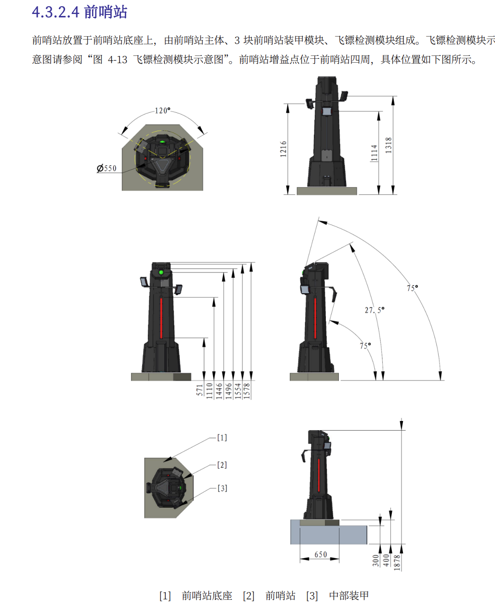
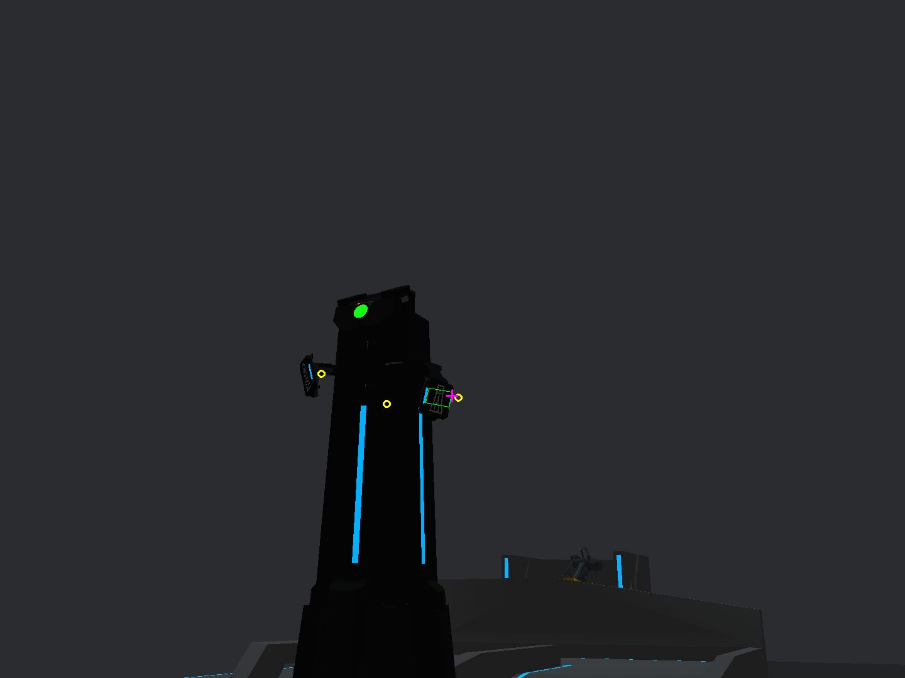

# 视觉大作业(自瞄系统搭建与目标滤波)

本仓库是作业模板。已有组件提供图像接收、装甲板检测、PnP、云台规划与通信、绘图和日志；目标管理、运动滤波与预测留给学生完成。`task1_sim` 和 `task2_real` 均提供参数解析、组件初始化和待填写的主循环，数据处理与组件调用由学生连接，尚未实现自动跟随或发射。

学习目标是读懂接口、自行搭建流水线，并通过实验验证滤波与预测。仿真用于开发自测，最终需要在实机运行。底层云台控制由教师提供，学生负责正确调用。

## 作业内容

### 一、搭建流水线并跟随平移装甲板(35%)

目标只做平移，本题不要求处理车体旋转和装甲板切换。自行编写程序，调用现有组件获得装甲板空间观测，实现 KF 与未来位置预测，再调用提供的规划和控制接口完成云台跟随。

- 画出自己的数据流图，说明主要接口的输入、输出、坐标系、单位和时间戳。
- 自行定义状态与模型，实现初始化、预测、观测更新；使用实际采集时间间隔。
- 说明初始协方差、过程噪声和观测噪声的选择依据。
- 对比直接使用观测、仅滤波、滤波并预测三种结果。
- 在匀速横移、停止、反向运动场景中运行，解释抖动、滞后和预测误差；短时丢帧处理可作为扩展。
- 使用 Plotter/PlotJuggler 和 Foxglove 展示实验数据

### 二、自主提出前哨站 EKF 模型(65%)

根据提供的机械结构资料和实际观测，自行设计前哨站状态估计模型，并实现最小可运行的 EKF。状态维数由学生决定，仓库不提供前哨状态定义、运动与观测方程或专用雅可比。

#### 前哨站结构与观测资料

前哨站包含固定主体、三块中部装甲模块及飞镖检测模块。本题关注旋转中部装甲的观测与预测。三块装甲在周向间隔 120°，并处于不同高度；旋转过程中，可见装甲板及检测数量会随视角变化。



图示尺寸按 mm 阅读，代码中的空间位置统一使用 m。实机几何尺寸和验收条件以提供的装置与资料为准。比赛资料可查阅 [RoboMaster 官方规则资料中心](https://bbs.robomaster.com/wiki/20204847/809871?source=7)。



仿真图来自本项目已有运行记录，展示前哨站外观、可见装甲板及调试叠加效果；其中检测框、圆点和十字是示例程序绘制的内容，需要自行实现数据发布与展示。

当前配套仿真器的常规旋转速度幅值为 `0.8π rad/s`，约 `2.513 rad/s`（`0.4 圈/s`）。按 `Shift+C` 可依次切换正常旋转、停止和反向，按 `F5` 切换外部跟随订阅；操作说明见 [仿真接口文档](sim_bridge/README.md)。这些是当前仿真设置，实机仍需根据实际观测估计运动。

以上只给出物理结构与实验信息。滤波状态、运动与观测模型、初始化及可见板变化的处理方法由学生自行设计。

可以先使用自己的模型在仿真中完成估计与预测，并接入实机。展示正常旋转和可见装甲板变化时的表现。

## 待完成文件

| 文件                      | 负责的内容                                                   |
| ------------------------- | ------------------------------------------------------------ |
| `src/task1_sim.cpp`       | 仿真入口、组件生命周期、主循环、异常与退出处理、调试数据发布 |
| `src/task2_real.cpp`      | 实机入口、图像与姿态接口调用、规划结果发送、仿真到实机的适配 |
| `task/auto_aim/target.*`  | 两题的目标滤波与未来预测；前哨模型由学生自行设计             |
| `task/auto_aim/tracker.*` | 观测组织、目标管理、初始化、更新、失锁与重置策略             |

文件中的 `TODO(学生)` 是待完成位置，可按自己的设计增加实现文件。控制器只依赖公开的预测接口，不读取学生滤波器内部状态排列。教师提供的组件与接口说明见 [sim_bridge/README.md](sim_bridge/README.md)，具体签名以头文件为准。

通用 EKF 运算位于 `tools/extended_kalman_filter.*`，可阅读和调用。它负责矩阵运算，物理模型、噪声选择、观测组织与预测策略仍由学生完成。检测、PnP、MPC 数值求解和底层通信不是本次要求重新实现的内容。

## 构建与运行

依赖 Eigen 3.4、OpenCV、yaml-cpp、fmt、spdlog、nlohmann-json、Boost.System、OpenVINO Runtime。检测器需要 OpenVINO，没有无 OpenVINO 的替代入口。检测模型路径和推理设备在 YAML 中配置。
仿真仓库: https://github.com/SAM0619TJ/robomaster_simulator.git

```bash
cmake -S . -B build -DCMAKE_BUILD_TYPE=Release
cmake --build build -j2
./build/task1_sim --config configs/simulator.yaml
```

上述运行会初始化组件并进入待填写的主循环；数据接收、控制和调试发布由学生完成，运行时限等循环选项也需自行应用。模拟器的构建、IPC、参数和调试工具连接见 [仿真接口说明](sim_bridge/README.md)。仓库不提供完成作业的自动验收测试，学生需要自行设计实验。

实机驱动通过 `BUILD_HARDWARE` 启用。相机 SDK、串口权限、设备名、标定及电控协议需要教师在设备上核验；仿真配置不能直接代替实机配置。编译成功不代表硬件链路已经跑通。

```bash
cmake -S . -B build-real -DCMAKE_BUILD_TYPE=Release -DBUILD_HARDWARE=ON
cmake --build build-real -j2
./build-real/task2_real configs/standard4.yaml
```

## 提交与验收
    大家在线下样车上部署代码,并在规定时间内完成调试.截止时间为2026.11.20
