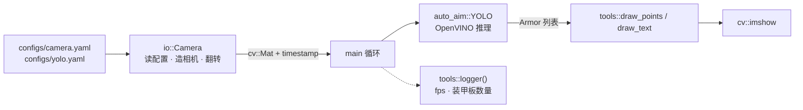

# homework_2 说明文档

## 一、作业概述

本次作业主要编写一个相机类的实现，并调用已经准备好的 yolo 来识别装甲板。主要代码分为 `my_camera.hpp`、`my_camera.cpp`、`main.cpp`，完成取图、识别、画框、显示。

## 二、数据流图

一句话：相机只负责给出一张图，识别只负责给出一串 Armor，两边互不依赖。

## 三、各文件说明

### 1. `my_camera.hpp` —— 类的声明

`my_camera.hpp` 为类的声明，包含一个相机的基类 `CameraBase`，只声明一个纯虚函数 `read()`，作用就是说明所有相机都要读图。后面两个相机类 `UsbCamera` 和 `HikCamera` 继承 `CameraBase` 后重写出自己的读图方式。最后有一个外观类 `Camera`，直接对接 main 函数，读取 `camera.yaml` 决定 new 出 USB 还是 Hik，并决定翻转方式。

### 2. `my_camera.cpp` —— 实现

`my_camera.cpp` 具体实现各种相机如何读图：

- USB 相机：OpenCV 已经实现，比较简单，直接读取图像并记录时间即可。
- Hik 相机：比较麻烦——
  1. 先打开：SDK 固定三步「枚举，找出所有连着的 USB 相机；用第 0 台创建句柄；打开这台相机」。
  2. 配置参数：白平衡、曝光时间、帧率等。
  3. read 开始读取：取一帧（超过 100ms 超时），转成 BGR（transfer 函数把 Bayer 格式转为 BGR，使用去马赛克算法），记录时间，再释放缓存区，才能继续取下一帧。
  4. 析构函数关闭相机。
- 外观类 `Camera`：通过 `camera.yaml` 声明即可调整相机类型、时间等参数。Camera 类读取这些信息，判断调用 USB 还是 Hik。

### 3. `main.cpp` —— 流水线编排

主函数把所有内容串起来：`while` 循环里逐帧读取图像（调用前面相机类的实现），读取完后用 yolo 函数开始识别，对每个识别到的画出框、角点、颜色，同时打印 fps 和装甲板数量。

## 四、关键参数取值理由（configs/camera.yaml）

| 参数 | 值 | 理由 |
|------|-----|------|
| `camera_name` | usb / hikrobot | 选哪台相机，外观类据此构造对应类 |
| `exposure_ms` | 3 | 曝光 3ms。装甲板灯条是主动光源、很亮，短曝光避免过曝，高速运动下也减少拖影 |
| `gain` | 16.9 | 增益。短曝光后画面偏暗，用它补亮度；太大噪点多，16.9 是调试折中值 |
| `vid_pid` | 2bdf:0001 | 海康相机的 USB 厂商ID:产品ID，用于识别是哪台设备 |
| `flip_code` | 2 | 相机安装方向需要校正；`cv::flip` 的 flipCode > 0 表示水平翻转（镜像） |

## 五、遇到的问题与解决方式

1. OpenVINO 路径写错：CMake 里 `OpenVINO_DIR` 写成了压缩包路径 `/opt/intel/openvino_2024.6.0`，实际 apt 安装后在 `/usr/lib/cmake/openvino2024.6.0`。改成真实路径（根 CMakeLists 和 `tasks/CMakeLists.txt` 两处）后 `find_package(OpenVINO REQUIRED)` 才通过。
2. fmt v10 裸枚举报错：`tasks/yolos/yolov5.cpp` 里直接格式化裸枚举 `armor.name`，fmt v10 报错，改成 `ARMOR_NAMES[armor.name]` 后编译通过。
3. `main.cpp` 的 include 文件名不对：写的是 `#include "io/camera.hpp"`，实际文件名是 `my_camera.hpp`，改对后才能编译。

## 六、注意事项 / 待改进

- `vid_pid` 目前只记录、未真正用于匹配设备（代码取的是第 0 台设备）；多相机场景需补上按 vid_pid 遍历匹配。
