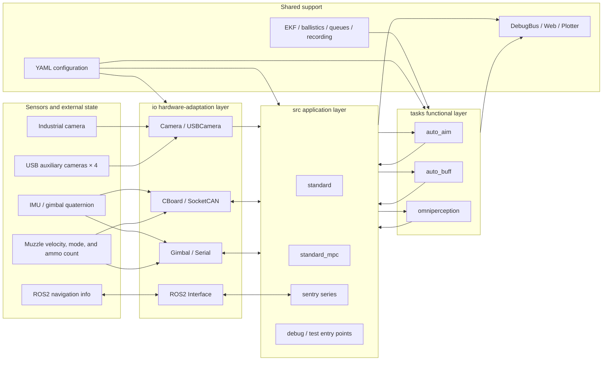
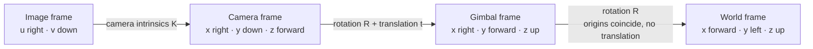

# Stage 3 Training: ROS2 Engineering and the Mathematical Logic of Auto-Aim

| Item              | Content                                                                                                                                       |
| ----------------- | -------------------------------------------------------------------------------------------------------------------------------------------- |
| Teaching goal      | Be able to package the detection algorithm into a ROS2 node and interface it with the simulator; be able to work backward from four pixel points to a target pose, and compute the commands the gimbal (云台, yúntái) can execute |
| Teaching focus     | Node (节点, jiédiǎn) / topic (话题, huàtí) / parameter (参数, cānshù) / packages and custom messages / `cv_bridge`; coordinate-frame transformation, PnP, whole-vehicle modeling (整车建模, zhěngchē jiànmó), EKF, ballistic solving (弹道解算, dàndào jiěsuàn) |
| Teaching difficulty | The engineering habit of "separating the algorithm from the node"; how to convert between coordinate frames, and how to evaluate solving error |
| Assessment method  | Submit the Stage 3 assignment: a ROS2 armor-plate detection node (Part 1) + pose solving and ballistic solving (Part 2)                        |

---

## Table of Contents

- [Stage 3 Training: ROS2 Engineering and the Mathematical Logic of Auto-Aim](#stage-3-training-ros2-engineering-and-the-mathematical-logic-of-auto-aim)
  - [Accompanying Examples](#accompanying-examples)
  - [Overview: the Full Auto-Aim Pipeline](#overview-the-full-auto-aim-pipeline)
  - [Part 1: ROS2 Engineering](#part-1-ros2-engineering)
    - [1.1 Why Auto-Aim Needs to Run on ROS2](#11-why-auto-aim-needs-to-run-on-ros2)
    - [1.2 Nodes, Topics, and Parameters](#12-nodes-topics-and-parameters)
    - [1.3 Packages: `ament_cmake` + `package.xml` + Custom Messages](#13-packages-ament_cmake--packagexml--custom-messages)
    - [1.4 `cv_bridge`: `sensor_msgs::Image` ↔ `cv::Mat`](#14-cv_bridge-sensor_msgsimage--cvmat)
    - [1.5 Thin Nodes: Wrapping Stage 2's Algorithm](#15-thin-nodes-wrapping-stage-2s-algorithm)
    - [1.6 Interfacing with the Daedalus Simulator](#16-interfacing-with-the-daedalus-simulator)
    - [1.7 Common Pitfalls](#17-common-pitfalls)
  - [Part 2: Coordinate-Frame Transformation and Pose Solving](#part-2-coordinate-frame-transformation-and-pose-solving)
    - [2.1 Common Coordinate Frames](#21-common-coordinate-frames)
    - [2.2 Rigid-Body Transformation: How to "Translate" Between Two Frames](#22-rigid-body-transformation-how-to-translate-between-two-frames)
    - [2.3 Camera Imaging Model: From the 3D World to a 2D Image](#23-camera-imaging-model-from-the-3d-world-to-a-2d-image)
    - [2.4 solvePnP](#24-solvepnp)
    - [2.5 Reprojection Error and Distance Estimation](#25-reprojection-error-and-distance-estimation)
  - [Part 3: The Kalman Filter](#part-3-the-kalman-filter)
    - [3.1 The Kalman Filter and Target State Estimation](#31-the-kalman-filter-and-target-state-estimation)
    - [3.2 From Pose Observations to Stable Tracking](#32-from-pose-observations-to-stable-tracking)
  - [Part 4: Understanding and Deriving the Kalman Filter](#part-4-understanding-and-deriving-the-kalman-filter)
    - [4.1 Intuition: Prediction and Measurement Correct Each Other](#41-intuition-prediction-and-measurement-correct-each-other)
    - [4.2 One-Dimensional Gain: Why That Particular Fraction](#42-one-dimensional-gain-why-that-particular-fraction)
    - [4.3 Time Subscripts and Every Quantity in the Model](#43-time-subscripts-and-every-quantity-in-the-model)
    - [4.4 Deriving the Matrix KF](#44-deriving-the-matrix-kf)
    - [4.5 EKF: Predict with a Function, Propagate Error with the Jacobian](#45-ekf-predict-with-a-function-propagate-error-with-the-jacobian)
    - [4.6 RoboMaster Four Armor Plates: From Plate Poses to Whole-Vehicle State](#46-robomaster-four-armor-plates-from-plate-poses-to-whole-vehicle-state)
      - [4.6.1 Pinning Down the Geometry and Coordinates](#461-pinning-down-the-geometry-and-coordinates)
      - [4.6.2 Motion Model, Observation Model, and Dimensions](#462-motion-model-observation-model-and-dimensions)
      - [4.6.3 Observability and Modeling Choices](#463-observability-and-modeling-choices)
    - [4.7 One-Frame Quick Reference](#47-one-frame-quick-reference)
  - [Part 5: The Stage 3 Assignment](#part-5-the-stage-3-assignment)
  - [Part 6: References](#part-6-references)

---

## Accompanying Examples

This stage doesn't add a new algorithm example: the detection algorithm directly reuses Stage 2's
[`tutorial_2/example/opencv/armor_detect.cpp`](../tutorial_2/example/opencv/armor_detect.cpp);
for the ROS2 engineering, build the package yourself following Part 1 below and the assignment requirements.

Runtime environment: Ubuntu 22.04 + ROS2 Humble (installation commands are in the "Development Environment" section of the root-level [`Readme.md`](../Readme.md)).

---

## Overview: the Full Auto-Aim Pipeline



Using this diagram as a map for what this stage covers:

- **The `ROS2 Interface` in the `io` layer**: this stage's Part 1 — how the algorithm talks to the outside world.
- **`auto_aim` in the `tasks` layer**: this stage's Parts 2 and 3 — how four points turn into a gimbal angle.
- Stage 2's results (the `ArmorDetector` class, the `Camera` abstract class) are used here directly as components.

---

## Part 1: ROS2 Engineering

### 1.1 Why Auto-Aim Needs to Run on ROS2

In Stage 2 we already wrote "armor-plate (装甲板, zhuāngjiǎbǎn) four-point detection" as a class: feed it an image, get four points out.
But once it's on the robot, it's not a standalone program — it's one link in a larger chain:

- **Upstream**: the camera (or simulator) keeps supplying images, along with camera intrinsics (相机内参, xiàngjī nèicān), gimbal attitude, and timestamps;
- **Peers**: other nodes are running alongside it (energy-mechanism (能量机关, néngliàng jīguān) detection, a radar station...);
- **Downstream**: ballistic solving needs the detection result, and the gimbal driver needs the solving result.

These modules might be written by different people, in different languages, running on different machines — and you need to be
able to swap any one of them out for debugging at any time. What ROS2 provides is exactly this set of conventions for "how modules talk to each other":

| The effect you want                     | The ROS2 concept for it               | The example in auto-aim                                 |
| ------------------------------------------ | ------------------------------------------ | ------------------------------------------------------------ |
| Upstream pushes images to me               | **Topic** (publish / subscribe, 发布 / 订阅, fābù / dìngyuè) | subscribe to `/image_raw`, publish `/armor_detector/detections` |
| I want someone else to do a task and wait for the result | **Service** (服务, fúwù)             | manually trigger a calibration / reload parameters           |
| Change a parameter at startup without recompiling | **Parameter** (参数)                | video path, binarization threshold, `kSizeWeight`            |
| Bundle several modules + launch with one command | **Package** (功能包, gōngnéng bāo) + `ros2 launch` | starting `video_publisher` + `armor_detector` together |

In one sentence: **ROS2 isn't an algorithm — it's an engineering skeleton.** The algorithm is still the same thing from Stage 2; it's just wrapped in an extra shell.

### 1.2 Nodes, Topics, and Parameters

A **node** (节点) is a process with its own name that can send and receive messages. Subscriptions, publishers, and parameters are all created on the node:

```cpp
class ArmorDetectorNode : public rclcpp::Node {
public:
  ArmorDetectorNode() : Node("armor_detector") {
    // 1. Parameter: can be overridden from the command line, no need to change code and recompile
    video_path_ = declare_parameter<std::string>("video_path", "demo.mp4");

    // 2. Subscription: note that the QoS must match the publisher's
    sub_ = create_subscription<sensor_msgs::msg::Image>(
        "/image_raw", rclcpp::SensorDataQoS(),
        [this](sensor_msgs::msg::Image::ConstSharedPtr msg) { onImage(msg); });

    // 3. Publisher
    pub_det_ = create_publisher<rm_interfaces::msg::ArmorDetections>(
        "/armor_detector/detections", 10);
  }
};

int main(int argc, char **argv) {
  rclcpp::init(argc, argv);          // everything starts from init
  rclcpp::spin(std::make_shared<ArmorDetectorNode>());  // blocks, waiting for callbacks
  rclcpp::shutdown();
  return 0;
}
```

Four debugging commands worth memorizing — these will be demonstrated live in class:

```bash
ros2 node list                     # which nodes exist right now
ros2 topic list                    # which topics exist right now
ros2 topic hz /image_raw           # is the frequency right (is the camera actually publishing?)
ros2 topic echo /armor_detector/detections --once   # is the message content right
```

> **QoS is the easiest thing to get tripped up on**: `/image_raw` is an image stream, so it uses `sensor_data` (best effort).
> If the subscriber uses the default `reliable`, you end up with "both nodes are running, but no images are being received."
> Remember: **for video-stream-type topics, both ends should use `rclcpp::SensorDataQoS()`.**

### 1.3 Packages: `ament_cmake` + `package.xml` + Custom Messages

A ROS2 package is "a CMake project that `colcon build` can build," plus two extra things: `package.xml`
(declares dependencies) and a standardized `install` convention.

```bash
ros2 pkg create --build-type ament_cmake armor_detector \
  --dependencies rclcpp sensor_msgs cv_bridge image_transport
```

The key lines in `CMakeLists.txt` are just these (it's the same CMake knowledge from Stage 1):

```cmake
find_package(ament_cmake REQUIRED)
find_package(rclcpp REQUIRED)
find_package(cv_bridge REQUIRED)

add_executable(armor_detector_node src/armor_detector_node.cpp)
ament_target_dependencies(armor_detector_node rclcpp sensor_msgs cv_bridge)

install(TARGETS armor_detector_node DESTINATION lib/${PROJECT_NAME})
ament_package()
```

**Custom messages (`rosidl`)**: each `.msg` file under the `msg/` directory is a message type (消息, xiāoxi):

```
# msg/ArmorDetection.msg
Point2d[4] pts
string type
float32 distance_to_image_center
float32 score
```

The basic types usable inside a `.msg` file are `bool int32 float32 string` and so on; to use a type from another
package, write the full name (`std_msgs/Header`, `geometry_msgs/Pose`). For other people to be able to use this
package's messages, `package.xml` must declare:

```xml
<buildtool_depend>rosidl_default_generators</buildtool_depend>
<member_of_group>rosidl_interface_packages</member_of_group>
```

Forget this line, and the message "fails to generate" — but the error points at a completely different file. This is
a classic pitfall everyone hits at least once.

Build and verify:

```bash
colcon build --packages-select armor_detector
source install/setup.bash          # don't forget! every new terminal needs this sourced again
ros2 interface show rm_interfaces/msg/ArmorDetections   # check the message structure is right
```

### 1.4 `cv_bridge`: `sensor_msgs::Image` ↔ `cv::Mat`

ROS2's image type is `sensor_msgs::msg::Image`, and our algorithm consumes `cv::Mat` — `cv_bridge` is what converts between the two:

```cpp
cv_bridge::CvImagePtr cv_ptr;
try {
  // toCvCopy: copies the data out. If you're going to binarize or draw lines afterward, you must use this
  cv_ptr = cv_bridge::toCvCopy(msg, sensor_msgs::image_encodings::BGR8);
} catch (const cv_bridge::Exception &e) {
  RCLCPP_ERROR(get_logger(), "cv_bridge conversion failed: %s", e.what());
  return;   // a failed conversion must not crash the node
}
const cv::Mat &bgr = cv_ptr->image;

// publish the drawn-on image back out
cv_bridge::CvImage out(msg->header, "bgr8", canvas);
pub_dbg_->publish(*out.toImageMsg());
```

> **`toCvCopy` vs. `toCvShare`**: `toCvShare` doesn't copy — the `cv::Mat` and the message share the same block of
> memory. If you then modify it with `threshold` / `line`, you've just modified the original image inside the message
> (and possibly corrupted data someone else is sharing too). Any time you're going to modify the image, use `toCvCopy`.

### 1.5 Thin Nodes: Wrapping Stage 2's Algorithm

**Don't write the algorithm inside the node.** The callback (回调, huídiào) does exactly four things, and the algorithm itself doesn't change a single line:

```cpp
void onImage(const sensor_msgs::msg::Image::ConstSharedPtr &msg) {
  const cv::Mat bgr = toMat(msg);          // 1. convert
  const auto armors = detector_->detect(bgr);  // 2. call the algorithm written in Stage 2

  rm_interfaces::msg::ArmorDetections out; // 3. assemble the message
  out.header = msg->header;
  for (const auto &a : armors) { out.detections.push_back(toMsg(a)); }
  pub_det_->publish(out);                  // 4. publish (empty detections too)
}
```

Why split it this way? Because this is what lets the algorithm be **tested independently of ROS**: Stage 2's
`armor_detect` runs just by feeding it an image directly, and later on it can be tested directly with GoogleTest too;
a node is full of `rclcpp` machinery, and once the algorithm gets mixed into it, it can never be separated from ROS again.

### 1.6 Interfacing with the Daedalus Simulator

The essence of the integration comes down to two statements:

1. **Publish the same topic**: the simulator publishes `/image_raw` (`sensor_msgs/msg/Image`), so you can swap out your
   own `video_publisher` and launch the simulator directly — the detection node doesn't need a single line changed;
2. **Use the same interface package**: the interface is the simulator's own `rm_interfaces` — don't start your own
   package under a different name, or the message types won't be recognized on both sides.

For the topic table, what's inside `rm_interfaces`, and how to switch to simulation during grading, see
[`homework_3.md`](homework_3.md) §1.3; for the simulator's keyboard shortcuts and the graduation-assessment requirements, see the root-level
[`Readme.md`](../Readme.md).

### 1.7 Common Pitfalls

- **QoS mismatch**: if the two ends don't match, no data gets received (the symptom is "the topic exists but `hz` shows 0").
- **Forgetting to `source install/setup.bash`**: `ros2 run` reports "package not found."
- **Assuming the image encoding**: `msg->encoding` could be `bgr8` / `rgb8` / `mono8` — hardcoding BGR8 will shift the colors.
- **Doing heavy work inside the callback**: `spin` is single-threaded, so if one frame stalls, frames get dropped; if the algorithm is heavy, use a multi-threaded executor.
- **Missing a dependency in `package.xml`**: it compiles fine, but fails to find the library at runtime (`ament_target_dependencies` needs the full list).
- **Hand-building the timestamp**: use `this->now()`, don't construct a `builtin_interfaces::msg::Time` yourself.
- **Not publishing on an empty detection**: downstream will think you've died. If nothing is detected, publish an empty array.

---

## Part 2: Coordinate-Frame Transformation and Pose Solving

**Training goal**: work backward from four points in the image to the armor plate's position and orientation in space (位姿解算, wèizī jiěsuàn).

### 2.1 Common Coordinate Frames

Coordinate frame = 坐标系 (zuòbiāoxì).

| Frame                          | Where the origin is fixed       | x axis points | y axis points | z axis points              |
| -------------------------------- | ---------------------------------- | -------------- | -------------- | ---------------------------- |
| Image frame (图像坐标系)         | top-left corner of the image       | right (u)      | down (v)       | — (2D)                       |
| Camera frame (相机坐标系)        | the camera's optical center        | right (x)      | down (y)       | forward (optical axis, z)    |
| Gimbal frame (云台坐标系)        | intersection of the gimbal's yaw/pitch rotation axes | right (x) | forward (y) | up (z)               |
| World frame (世界坐标系)         | intersection of the gimbal's rotation axes | forward (x) | left (y)  | up (z)                       |



### 2.2 Rigid-Body Transformation (刚体变换, gāngtǐ biànhuàn): How to "Translate" Between Two Frames

$$
P_B = R_{A2B}\, P_A + T_{A2B}
$$

where:

$$
\begin{aligned}
P_A,\; P_B &\in \mathbb{R}^{3 \times 1} && \text{the same point's coordinates in frame A and frame B} \\
R_{A2B} &\in \mathbb{R}^{3 \times 3} && \text{rotation matrix: how much frame A must be "twisted" to align with frame B's orientation} \\
T_{A2B} &\in \mathbb{R}^{3 \times 1} && \text{translation vector: the position of frame A's origin in frame B}
\end{aligned}
$$

> Intuition: first twist the point in frame A by \(R\) so it faces the same direction as frame B, then shift the origin by \(T\).
>
> One property of the rotation matrix (旋转矩阵, xuánzhuǎn jǔzhèn) \(R\): it is an orthogonal matrix, meaning \(R^{-1} = R^{\mathsf{T}}\). When you need the reverse transformation (from B to A), you can just use the transpose: \(P_A = R_{A2B}^{\mathsf{T}}(P_B - T_{A2B})\).
>
> And where does the rotation matrix itself come from? The most common way is to describe it with Euler angles (欧拉角, ōulā jiǎo: yaw, pitch, roll). In the RoboMaster auto-aim system, these three angles come from the gimbal's IMU, and represent rotation about the Z, X, and Y axes respectively.

### 2.3 Camera Imaging Model: From the 3D World to a 2D Image

A camera is essentially a 3D → 2D projector. The most commonly used model is the pinhole model (小孔成像, xiǎokǒng chéngxiàng).

A point in the camera frame

$$
P_{\mathrm{cam}} = \begin{bmatrix} X \\ Y \\ Z \end{bmatrix}
$$

projects to pixel coordinates \((u, v)\):

$$
u = f_x \frac{X}{Z} + c_x, \qquad
v = f_y \frac{Y}{Z} + c_y
$$

Written as an intrinsic matrix:

$$
\begin{bmatrix} u \\ v \\ 1 \end{bmatrix}
=
\frac{1}{Z}\,
K
\begin{bmatrix} X \\ Y \\ Z \end{bmatrix},
\qquad
K =
\begin{bmatrix}
f_x & 0 & c_x \\
0 & f_y & c_y \\
0 & 0 & 1
\end{bmatrix}
$$

where:

$$
\begin{aligned}
f_x,\; f_y &\in \mathbb{R} && \text{focal length, in pixels} \\
c_x,\; c_y &\in \mathbb{R} && \text{principal point: where the optical axis lands on the image, usually near the image center} \\
\dfrac{X}{Z},\; \dfrac{Y}{Z} &&& \text{normalized coordinates: the larger } Z \text{ is, the closer the point lands to the image center (perspective effect)}
\end{aligned}
$$

> These 4 numbers `(fx, fy, cx, cy)` together with the radial distortion (畸变, jībiàn) coefficients `(k1, k2, p1, p2, k3)` make up the camera's intrinsic parameters (内参, nèicān). Calibrating the intrinsics is the process of determining these numbers.

### 2.4 solvePnP

The core action in this document — working backward from 2D image corner points to the armor plate's 3D position — is just the reverse of the process above: PnP (Perspective-n-Point). You feed `solvePnP` the relative positions of 4 known 3D points (the armor-plate model points) and their projections in the image (the corner points detected by the neural network), and it computes the armor plate's 3D position in the camera frame.

PnP (Perspective-n-Point) is the algorithm behind `solvePnP`. Its inputs are:

- 4 3D points (the armor plate's physical dimensions — a small armor plate is 13.5 cm × 5.6 cm)
- 4 corresponding 2D projection points (the corner points detected in the image)
- the camera intrinsics \(K\) and distortion coefficients

The output is the 3D position and orientation in the camera frame.

```cpp
cv::solvePnP(centers_3d_, centers_2d, camera_matrix, distort_coeffs,
             rvec, tvec,
             false, cv::SOLVEPNP_IPPE);

// returned as rvec and tvec
cv::Mat rmat;
// we need to convert the rotation vector and translation vector into matrix form
cv::Rodrigues(rvec, rmat);
Eigen::Matrix3d R_armor2camera;
// convert to an Eigen matrix
cv::cv2eigen(rmat, R_armor2camera);
```

> This is how we obtain the 3D information.
> For the principle behind the PnP algorithm, if you're interested, see https://zhuanlan.zhihu.com/p/698620045.

### 2.5 Reprojection Error (重投影误差, chóng tóuyǐng wùchā) and Distance Estimation

The `rvec` and `tvec` that `solvePnP` gives still have to pass two checks: is this solution trustworthy, and how far is the target from the camera.

**Distance.** The translation vector (平移向量, píngyí xiàngliàng) \(\mathbf{t}\) is the coordinates of the armor-plate model's origin in the camera frame. When the model origin is placed at the armor plate's center, it is the camera-frame coordinates of the center point:

$$
\mathbf{t} = \begin{bmatrix} t_x \\ t_y \\ t_z \end{bmatrix},
\qquad
d = \|\mathbf{t}\|_2 = \sqrt{t_x^2 + t_y^2 + t_z^2}
$$

The unit of \(d\) matches the model points: if the model is in meters, the distance is in meters. \(t_z\) is just the depth along the optical axis; when the target is not at the image center, the slant distance \(d\) is larger than \(|t_z|\). The ballistics later on need this 3D point — you can't keep only \(t_z\).

**Reprojection error.** Use the solved \(R\) and \(\mathbf{t}\) to transform the model points back into the camera frame, then project them back to pixels using the intrinsics from 2.3, and compare against the detected corner points:

$$
P_{\mathrm{cam}, i} = R\, P_i + \mathbf{t}
$$

$$
e = \frac{1}{n}\sum_{i=1}^{n}
\left\|
\begin{bmatrix} u_i \\ v_i \end{bmatrix}
-
\begin{bmatrix} u'_i \\ v'_i \end{bmatrix}
\right\|_2
$$

\((u_i, v_i)\) is the detected corner point, \((u'_i, v'_i)\) is the pixel projected back, and the unit of \(e\) is pixels. When the corner points, the model, and the intrinsics are all correct, \(e\) is usually a few pixels; once it reaches a dozen or more pixels, this frame should not be fed into the filter that follows. Common causes: the order of the four corner points doesn't match the order of the model points, a large armor plate's dimensions were used for a small armor plate, or the intrinsics / distortion are wrong.

For four coplanar points, IPPE gives two solutions, and `SOLVEPNP_IPPE` keeps the one with the smaller reprojection error. You still need to compute the error yourself, to throw away bad detections. `projectPoints` also accounts for distortion, using the same set of coefficients as `solvePnP`.

```cpp
std::vector<cv::Point2f> projected;
cv::projectPoints(centers_3d_, rvec, tvec, camera_matrix, distort_coeffs, projected);

double sum = 0.0;
for (size_t i = 0; i < centers_2d.size(); ++i) {
  sum += cv::norm(centers_2d[i] - projected[i]);
}
const double reproj_err = sum / static_cast<double>(centers_2d.size()); // pixels
const double distance = cv::norm(tvec); // same unit as the model points
```

---

## Part 3: The Kalman Filter (卡尔曼滤波, kǎ'ěrmàn lǜbō)

**Why do we need a Kalman filter?**

In an auto-aim system, every frame you can measure the target armor plate's 3D position \((x, y, z)\). But you have two problems:

1. The measurements are noisy: the neural network's corner points and the IMU data aren't perfect, so the \((x, y, z)\) you get jitters around the true value.
2. You also need velocity: knowing position alone isn't enough — you need to know where the target is moving and how fast, so that you can predict where it will show up next.

The Kalman filter is the mathematical tool that solves both problems at once. Its core idea fits in one sentence:

> "I don't fully trust the measurement, and I don't fully trust the prediction either — I take a weighted average between the two, according to each one's noise level."

A more intuitive way to think about it: suppose you have two sensors measuring the same temperature, one accurate to ±1°C, the other to ±5°C. When you get both readings, you'd trust the first sensor's reading more, but you wouldn't ignore the second entirely either — what the Kalman filter does is calculate exactly that "weighting ratio."

In an auto-aim system, the Kalman filter is used to estimate the target's true position and velocity from a sequence of observed 3D positions. Its input is the `(x, y, z, yaw)` solved by PnP, and its output is the smoothed `(x, vx, y, vy, z, vz, yaw, vyaw)` — each dimension contains position + velocity.

### 3.1 The Kalman Filter and Target State Estimation

Goal: from the frame-by-frame 4D observations `(x, y, z, yaw)`, smooth the noise and estimate the velocity components `(vx, vy, vz, vyaw)`.

The state is 8-dimensional; the observation only has position and yaw, and velocity is inferred from the model:

$$
\mathbf{x} =
\begin{bmatrix}
x & v_x & y & v_y & z & v_z & \mathrm{yaw} & v_{\mathrm{yaw}}
\end{bmatrix}^{\mathsf{T}},
\qquad
\mathbf{z} =
\begin{bmatrix}
x & y & z & \mathrm{yaw}
\end{bmatrix}^{\mathsf{T}}
$$

In the constant-velocity model, each "position–velocity" pair is advanced by \(\Delta t\) using the same block \(F_2\), and the whole state's transition matrix (状态转移矩阵, zhuàngtài zhuǎnyí jǔzhèn) is assembled from four blocks:

$$
F_2 = \begin{bmatrix} 1 & \Delta t \\ 0 & 1 \end{bmatrix},
\qquad
F =
\begin{bmatrix}
F_2 & 0 & 0 & 0 \\
0 & F_2 & 0 & 0 \\
0 & 0 & F_2 & 0 \\
0 & 0 & 0 & F_2
\end{bmatrix}
$$

The observation matrix just picks out \(x, y, z, \mathrm{yaw}\); the columns where velocity lives are 0:

$$
H =
\begin{bmatrix}
1 & 0 & 0 & 0 & 0 & 0 & 0 & 0 \\
0 & 0 & 1 & 0 & 0 & 0 & 0 & 0 \\
0 & 0 & 0 & 0 & 1 & 0 & 0 & 0 \\
0 & 0 & 0 & 0 & 0 & 0 & 1 & 0
\end{bmatrix},
\qquad
\mathbf{z} = H\mathbf{x}
$$

\(P\) is the state covariance (协方差, xiéfāngchā), \(8\times 8\). \(Q\) expresses how inaccurate the constant-velocity model itself is (the process noise, 过程噪声, guòchéng zàoshēng), discretized from acceleration white noise, one block per axis:

$$
Q_p = \sigma_p^2
\begin{bmatrix}
\Delta t^4 / 4 & \Delta t^3 / 2 \\
\Delta t^3 / 2 & \Delta t^2
\end{bmatrix},
\qquad
Q = \mathrm{blkdiag}(Q_x, Q_y, Q_z, Q_{\mathrm{yaw}})
$$

\(R\) is the noise of the PnP observation (测量噪声, cèliáng zàoshēng), \(4\times 4\):

$$
R = \mathrm{diag}(\sigma_x^2,\; \sigma_y^2,\; \sigma_z^2,\; \sigma_{\mathrm{yaw}}^2)
$$

**Predict** (push the previous frame forward to this frame, with no new observation yet):

$$
\hat{\mathbf{x}}_{k|k-1} = F\, \hat{\mathbf{x}}_{k-1|k-1}
$$

$$
P_{k|k-1} = F\, P_{k-1|k-1}\, F^{\mathsf{T}} + Q
$$

**Update** (this frame's \(\mathbf{z}_k\) has arrived; compromise between it and the prediction according to noise levels):

$$
\mathbf{y}_k = \mathbf{z}_k - H\, \hat{\mathbf{x}}_{k|k-1}
$$

$$
S_k = H\, P_{k|k-1}\, H^{\mathsf{T}} + R,
\qquad
K_k = P_{k|k-1}\, H^{\mathsf{T}}\, S_k^{-1}
$$

$$
\hat{\mathbf{x}}_{k|k} = \hat{\mathbf{x}}_{k|k-1} + K_k\, \mathbf{y}_k
$$

$$
P_{k|k} = (I - K_k H)\, P_{k|k-1}
$$

\(K_k\) is exactly the weighting ratio (增益, zēngyì — the gain) mentioned earlier. When \(R\) is small and the observation is more accurate, \(K_k\) is larger and more of the residual is absorbed; when the predicted covariance is small and the model is more trustworthy, \(K_k\) is smaller and the result stays closer to the prediction.

The first frame has no velocity: fill \(\mathbf{z}\) into \(x, y, z, \mathrm{yaw}\), and set the four velocities to 0. When applying lead (提前量, tíqiánliàng), push forward by one flight time using the predict equation; no update is done in this step.

> The yaw residual must first be wrapped into \((-\pi, \pi]\). If it's off by a full \(2\pi\), the filter will think the target has rotated a whole circle.

### 3.2 From Pose Observations to Stable Tracking

3.1 tracks the armor plate's center. Once the vehicle rotates, the plate facing you switches to the next one, and the observed \(x\), \(y\), and \(\mathrm{yaw}\) jump, which throws the velocity way off. What you actually need to track is the vehicle's center: it moves at nearly constant velocity, and an armor plate is just one point sitting outside that center at radius \(r\). The observation and the state are no longer the same set of quantities, the observation function becomes nonlinear, and the filter changes from a Kalman filter to an Extended Kalman Filter (扩展卡尔曼滤波, kuòzhǎn kǎ'ěrmàn lǜbō — EKF).

**State and motion model.** 11 dimensions. The first 8 are the center's position, velocity, and the orientation of the currently visible plate; the last 3 are geometric quantities, which can differ between the two pairs of armor plates:

$$
\mathbf{x} =
\begin{bmatrix}
x & v_x & y & v_y & z & v_z & a & w & r & l & h
\end{bmatrix}^{\mathsf{T}}
$$

| Symbol    | Meaning                                                                       |
| ---------- | --------------------------------------------------------------------------------- |
| \(x, y\)   | horizontal position of the rotation center                                    |
| \(z\)      | height of the currently visible pair of armor plates                          |
| \(a\)      | yaw of the currently visible plate, positive when rotating from world \(x\) toward \(y\) |
| \(w\)      | yaw angular velocity                                                          |
| \(r\)      | horizontal radius from the center to the current pair of plates (\(a\) and \(a+\pi\)) |
| \(l\)      | horizontal radius from the center to the other pair of plates (\(a\pm\pi/2\)) |
| \(h\)      | height difference of the other pair relative to the current height; the other pair's height is \(z+h\) |

The center moves at constant velocity, \(a\) rotates at constant angular velocity, and \(r, l, h\) are treated as unchanging:

$$
F = \mathrm{blkdiag}(F_2, F_2, F_2, F_2, 1, 1, 1),
\qquad
F_2 = \begin{bmatrix} 1 & \Delta t \\ 0 & 1 \end{bmatrix}
$$

The prediction equations are the same as in 3.1: \(\hat{\mathbf{x}}_{k|k-1} = F\hat{\mathbf{x}}\), \(P_{k|k-1} = FPF^{\mathsf{T}} + Q\).

**Observation model.** What PnP gives is the currently visible armor plate. The normal direction is taken as \((\cos a,\; \sin a)\), and the plate's center is offset from the center outward along the normal by \(r\). The observation function is written \(h(\mathbf{x})\), which is not the same quantity as the height difference \(h\) in the state:

$$
h(\mathbf{x}) =
\begin{bmatrix}
x + r\cos a \\
y + r\sin a \\
z \\
a
\end{bmatrix}
$$

The currently visible plate only uses \(r\) and \(z\). \(l\) and the height difference \(h\) only get updated after the track jumps to the other pair of plates and swaps them into \(r\) and \(z\). The Jacobian (雅可比, yǎkěbǐ) \(H = \partial h / \partial \mathbf{x}\) is \(4\times 11\), with columns in the same order as the state; the two columns for \(l\) and the height difference are 0:

$$
H =
\begin{bmatrix}
1 & 0 & 0 & 0 & 0 & 0 & -r\sin a & 0 & \cos a & 0 & 0 \\
0 & 0 & 1 & 0 & 0 & 0 & r\cos a & 0 & \sin a & 0 & 0 \\
0 & 0 & 0 & 0 & 1 & 0 & 0 & 0 & 0 & 0 & 0 \\
0 & 0 & 0 & 0 & 0 & 0 & 1 & 0 & 0 & 0 & 0
\end{bmatrix}
$$

In the update, the residual uses the nonlinear \(h\), and the gain uses this \(H\) (evaluated at \(\hat{\mathbf{x}}_{k|k-1}\)):

$$
\mathbf{y}_k = \mathbf{z}_k - h(\hat{\mathbf{x}}_{k|k-1})
$$

$$
S_k = H P_{k|k-1} H^{\mathsf{T}} + R,
\qquad
K_k = P_{k|k-1} H^{\mathsf{T}} S_k^{-1}
$$

$$
\hat{\mathbf{x}}_{k|k} = \hat{\mathbf{x}}_{k|k-1} + K_k \mathbf{y}_k,
\qquad
P_{k|k} = (I - K_k H)\, P_{k|k-1}
$$

The residual for the \(a\) dimension is still first wrapped into \((-\pi, \pi]\).

For the four plates, first try out a plate-jump (跳板, tiàobǎn) \(\delta\) on a copy of the state, then compute \(h(\mathbf{x})\) and \(H\) using the post-jump state. Only after one is selected do you write it back to the state; the center's \(x, y\) don't jump.

| \(\delta\)   | How to modify the state before writing it back                                                              |
| ------------- | ---------------------------------------------------------------------------------------------------------------- |
| \(0\)         | still the current plate                                                                                         |
| \(\pi\)       | \(a \leftarrow a+\pi\). The opposite plate, same pair; \(r, l, z, h\) all stay unchanged                           |
| \(\pm\pi/2\)  | switch to the other pair: \(a \leftarrow a+\delta\), \(z \leftarrow z+h\), \(h \leftarrow -h\), and \(r\) and \(l\) swap |

**Mahalanobis-distance matching (马氏距离, mǎshì jùlí).** A single frame may contain multiple plates and multiple vehicles, and you also have to pick one among the plate-jump hypotheses. Use the residual and the innovation covariance (创新协方差, chuàngxīn xiéfāngchā) \(S_k\) to compute the Mahalanobis distance:

$$
d_M^2 = \mathbf{y}_k^{\mathsf{T}} S_k^{-1} \mathbf{y}_k
$$

When \(S_k\) is large (just initialized, lost for a while, or the target is far away and the observation is noisy), the same metric-scale error gives a smaller \(d_M^2\), so the gate is wider; once locked on, the gate narrows automatically. For a 4D observation, the 95% chi-square threshold is \(9.49\). For every detection and every \(\delta\), compute \(d_M^2\) once, and take the smallest one that passes the threshold. If none passes, this frame only predicts and doesn't update; if it fails for several consecutive frames, delete this track (航迹, hángjì).

**Noise.** \(Q\) is still discretized from acceleration white noise as in 3.1, specified separately per channel:

| Channel            | How to specify it                                                                          |
| -------------------- | ---------------------------------------------------------------------------------------------- |
| \(v_x, v_y, v_z\)  | ground vehicles don't accelerate much, so give a small \(\sigma\)                              |
| \(w\)              | a "spinning top" (小陀螺, xiǎotuóluó) can suddenly start spinning, so \(\sigma_w\) must be larger than for translation, otherwise yaw can't keep up |
| \(r, l, h\)        | the geometric quantities barely change, so give a very small process noise, letting them converge slowly |

\(R\) varies with distance. The pixel error \(\sigma_{\mathrm{pix}}\) projected into object space: the lateral component is roughly proportional to depth, and the depth error along the optical axis has an extra factor of "plate width \(L\)":

$$
\sigma_{xy} \approx \frac{z}{f_x}\sigma_{\mathrm{pix}},
\qquad
\sigma_z \approx \frac{z^2}{f_x L}\sigma_{\mathrm{pix}}
$$

\(f_x\) is in pixels; \(z\) and \(L\) use the same length unit. At close range \(R\) is small and the observation is trusted more; at long range \(R\) is large and the prediction is trusted more. The Mahalanobis gate is exactly this \(R\) added into \(S_k\), so a long-range target won't get wrongly deleted by a fixed metric-scale threshold.

The initial values of \(r\) and \(l\) both use the approximate size of the vehicle body's radius (a few tenths of a meter), and the initial height difference \(h\) is 0. On the first frame, subtract \(r(\cos a,\; \sin a)\) from the armor plate's position to get the center, and set the velocities and \(w\) to 0.

---

## Part 4: Understanding and Deriving the Kalman Filter

Starting from "how much should you trust one measurement," work step by step to the matrix KF, the EKF, and RoboMaster four-armor-plate whole-vehicle modeling. Vectors in the text are column vectors by default, \(T\) denotes transpose, and all covariances are defined with respect to estimation error.

### 4.1 Intuition: Prediction and Measurement Correct Each Other

A robot has two pieces of information about its current position: the **prediction** obtained by running the previous frame's state through the motion model, and the **measurement** given by the sensor. Both carry error. The Kalman filter computes weights according to each one's uncertainty: the more accurate the prediction, the more it keeps the prediction; the more accurate the measurement, the closer it moves to the measurement. It then updates the uncertainty and proceeds to the next frame.

Under the conditions of a linear model, Gaussian noise, and a correct model, the KF gives the minimum-mean-square-error estimate; under more general conditions, it can still be understood as a covariance-based recursive fusion method. The EKF makes a first-order approximation of the nonlinear model near the current estimate.

### 4.2 One-Dimensional Gain: Why That Particular Fraction

Let the prediction be $\hat x^-$ with prediction error variance $P^-$; directly measure $z=x+v$, where $E[v]=0$ and $\operatorname{Var}(v)=R$. The prediction error and the measurement noise are uncorrelated. Take the weighted update

$$
\hat x^+=\hat x^-+K(z-\hat x^-)=(1-K)\hat x^-+Kz.
$$

Let the prediction error be $e^-=x-\hat x^-$; then the update error is $e^+=(1-K)e^--Kv$, so

$$
P^+(K)=(1-K)^2P^-+K^2R.
$$

Differentiate with respect to $K$ and set it to zero:

$$
\frac{dP^+}{dK}=-2(1-K)P^-+2KR=0
\quad\Longrightarrow\quad
\boxed{K=\frac{P^-}{P^-+R}}.
$$

Substituting back gives $P^+=P^-R/(P^-+R)=(1-K)P^-$. For example, with $\hat x^-=10$, $P^-=4$, $z=13$, $R=9$, we get $K=4/13$, $\hat x^+=10+12/13\approx10.923$, $P^+=36/13\approx2.769$. The variances $4$ and $9$ are not standard deviations; here the measurement is less accurate, so the correction is limited in size.

### 4.3 Time Subscripts and Every Quantity in the Model

$\hat x_{a|b}$ means "the estimate of the state at **time $a$**, having used data up to **time $b$**." So $k-1|k-1$ is after the previous frame's update, $k|k-1$ is after this frame's prediction but before using this frame's measurement, and $k|k$ is after this frame's update. $P$ uses the same subscripts; the superscripts $-$ and $+$ in the previous section are shorthand for $k|k-1$ and $k|k$ respectively.

Let the state be $x_k\in\mathbb R^n$ and the observation $z_k\in\mathbb R^m$; the linear model is

$$
x_k=F_kx_{k-1}+w_k,\qquad z_k=H_kx_k+v_k.
$$

| Quantity       | Dimension              | Meaning                                                                         |
| -------------- | ---------------------- | ----------------------------------------------------------------------------------- |
| $F_k$          | $n\times n$            | state-transition matrix: how the previous frame's state becomes this frame's state |
| $H_k$          | $m\times n$            | linear observation matrix: how the state generates the observation               |
| $P_{a\vert b}$ | $n\times n$            | state-estimation error covariance, containing both each quantity's variance and the correlations between them |
| $w_k,\ Q_k$    | $n\times1,\ n\times n$ | process noise and its covariance $E[w_kw_k^T]=Q_k$                               |
| $v_k,\ R_k$    | $m\times1,\ m\times m$ | measurement noise and its covariance $E[v_kv_k^T]=R_k$                           |

Noise is usually assumed to be zero-mean, and $w_k$, $v_k$ are assumed uncorrelated with the relevant prior estimation error (先验, xiānyàn — prior); the covariance formulas below depend on these assumptions. $v_k$ is a noise vector — don't confuse it with the velocity in the state. A larger $Q$ means less trust in the motion model, and a larger $R$ means less trust in the measurement; their specific values should be determined from error statistics and real data.

For a constant-velocity position–velocity state $x=[p,\dot p]^T$, with sampling interval $\Delta t$,

$$
F=\begin{bmatrix}1&\Delta t\\0&1\end{bmatrix},\qquad
H=\begin{bmatrix}1&0\end{bmatrix}
$$

means position is extrapolated from velocity, while the sensor only measures position. If random acceleration is used to describe the model error, $Q$ can be obtained by discretizing the acceleration noise through the dynamics, rather than simply setting it to an identity matrix.

### 4.4 Deriving the Matrix KF

**Predict.** Feed the previous frame's updated state into the motion model:

$$
\boxed{\hat x_{k|k-1}=F_k\hat x_{k-1|k-1}}.
$$

Since the prediction error is $e_{k|k-1}=F_ke_{k-1|k-1}+w_k$, and assuming the cross-covariance is zero,

$$
\boxed{P_{k|k-1}=F_kP_{k-1|k-1}F_k^T+Q_k}.
$$

This also explains why the right-hand side has $P_{k-1|k-1}$: the prediction starts from the previous frame's result **after the previous frame's measurement has already been fused in**.

**Innovation (创新, chuàngxīn).** The predicted measurement is $\hat z_{k|k-1}=H_k\hat x_{k|k-1}$, and the difference between the actual measurement and it is

$$
y_k=z_k-H_k\hat x_{k|k-1}.
$$

From $y_k=H_k(x_k-\hat x_{k|k-1})+v_k$ we get

$$
\boxed{S_k=\operatorname{Cov}(y_k)=H_kP_{k|k-1}H_k^T+R_k}.
$$

$H_kP_{k|k-1}H_k^T$ is the **covariance of the state-prediction error projected into observation space**, of dimension $m\times m$; adding the measurement noise gives the innovation covariance $S_k$. In the scalar example they are $4$ and $9$ respectively, so $S=13$. The matrix also contains correlations between observed quantities, so you can't just look at a single "size."

**Gain.** Let $\hat x_{k|k}=\hat x_{k|k-1}+K_ky_k$, where $K_k\in\mathbb R^{n\times m}$. Its error covariance is

$$
P_{k|k}(K)=(I-KH)P^-(I-KH)^T+KRK^T,
$$

where for brevity the $k$ subscript is omitted and $P^-=P_{k|k-1}$. Expanding and taking the derivative of the trace $\operatorname{tr}P_{k|k}(K)$ with respect to $K$ gives

$$
-2P^-H^T+2K(HP^-H^T+R)=0,
$$

so when $S$ is invertible,

$$
\boxed{K_k=P_{k|k-1}H_k^TS_k^{-1}},\qquad
\boxed{\hat x_{k|k}=\hat x_{k|k-1}+K_ky_k}.
$$

In engineering practice, $K$ is usually obtained by solving a linear system, avoiding explicitly computing the inverse. For the covariance, the numerically more robust Joseph form is recommended for the update:

$$
\boxed{P_{k|k}=(I-K_kH_k)P_{k|k-1}(I-K_kH_k)^T+K_kR_kK_k^T}.
$$

Under exact arithmetic and the optimal gain, it is equivalent to $(I-K_kH_k)P_{k|k-1}$. Note that you can't claim "the gain gets smaller" just because $S$ gets larger, without knowing why: if what increased is $R$, you generally trust the measurement less; if what increased is $P^-$, then in the scalar case you rely on the measurement more instead.

### 4.5 EKF: Predict with a Function, Propagate Error with the Jacobian

The nonlinear model is written $x_k=f_k(x_{k-1})+w_k$, $z_k=g_k(x_k)+v_k$; here $g$ denotes the observation function, to avoid clashing with the height difference $h$ below. Expand to first order around the current estimate:

$$
f_k(\hat x+\delta x)\approx f_k(\hat x)+F_k\delta x,
\qquad F_k=\left.\frac{\partial f_k}{\partial x}\right|_{\hat x_{k-1|k-1}},
$$

$$
g_k(\hat x^-+\delta x)\approx g_k(\hat x^-)+H_k\delta x,
\qquad H_k=\left.\frac{\partial g_k}{\partial x}\right|_{\hat x_{k|k-1}}.
$$

So the EKF uses

$$
\begin{aligned}
\hat x_{k|k-1}&=f_k(\hat x_{k-1|k-1}), &P_{k|k-1}&=F_kP_{k-1|k-1}F_k^T+Q_k,\\
y_k&=z_k-g_k(\hat x_{k|k-1}), &S_k&=H_kP_{k|k-1}H_k^T+R_k,\\
K_k&=P_{k|k-1}H_k^TS_k^{-1}, &\hat x_{k|k}&=\hat x_{k|k-1}+K_ky_k.
\end{aligned}
$$

$P_{k|k}$ can still be computed in Joseph form. **In the EKF, $H_k$ only maps a small state error $\delta x$ locally to an observation error $\delta z$; in general you cannot write $\hat z=H_k\hat x$ — you must use the nonlinear function $g_k(\hat x)$.** Likewise, the EKF's $F_k$ is the Jacobian of $f_k$, and the mean prediction still uses $f_k$. The first-order approximation is only reliable near the estimate; angle residuals must be wrapped periodically, and incorrect data association or excessive linearization error will destroy the estimate.

### 4.6 RoboMaster Four Armor Plates: From Plate Poses to Whole-Vehicle State

#### 4.6.1 Pinning Down the Geometry and Coordinates

Take the vehicle-body frame's origin to be the symmetry center of the four plates' horizontal projection, with $x_b,y_b$ as mutually perpendicular horizontal axes and $z_b$ pointing up. $A_1,A_3$ are the first pair of opposite armor plates, and $A_2,A_4$ the second pair. Define $d_1,d_2>0$ as the **horizontal spacing between the centers of each pair**, and $r=d_1-d_2$ as the signed difference; if the two pairs are at different heights, you can't directly use the 3D Euclidean distance between plate centers as the $d_i$ here.

Let $\bar d=(d_1+d_2)/2$; then

$$
d_1=\bar d+\frac r2,\qquad d_2=\bar d-\frac r2,
\qquad d_1,d_2>0.
$$

Let the first pair's plate-center height be $z_c+\eta_1$ and the second pair's be $z_c+\eta_2$. Take $z_c$ to be the average of the two groups' heights, and $h=\eta_1-\eta_2$, so $\eta_1=h/2$ and $\eta_2=-h/2$. The four plate centers' positions in the vehicle-body frame are

$$
\begin{aligned}
b_1&=[d_1/2,\ 0,\ h/2]^T,&b_3&=[-d_1/2,\ 0,\ h/2]^T,\\
b_2&=[0,\ d_2/2,\ -h/2]^T,&b_4&=[0,\ -d_2/2,\ -h/2]^T.
\end{aligned}
$$

This assumes the two plates within each pair are at equal height, and the two pairs share one horizontal symmetry center; if the real structure doesn't satisfy this, offset parameters should be added. $r$ denotes the **difference between the two pairs' spacings** — it is not the radius from some plate to the center, nor the difference in distance between "two plates within the same pair." From dual-axis symmetry and $r$ alone, the absolute size can't be determined: you also need to know $\bar d$, or estimate $d_1,d_2$ separately. For example, with $d_1=0.40\,\mathrm m$ and $d_2=0.30\,\mathrm m$, $\bar d=0.35\,\mathrm m$ and $r=0.10\,\mathrm m$, and the two groups' radii are $0.20$ and $0.15\,\mathrm m$ respectively.

#### 4.6.2 Motion Model, Observation Model, and Dimensions

If $\bar d$ has already been given by mechanical drawings or reliable calibration, a $10$-dimensional state can be used:

$$
X=[c_x,c_y,c_z,v_x,v_y,v_z,\psi,\omega,r,h]^T\in\mathbb R^{10}.
$$

Predict with constant velocity and constant yaw angular velocity: $c_k=c_{k-1}+v_{k-1}\Delta t$, $v_k=v_{k-1}$, $\psi_k=\psi_{k-1}+\omega_{k-1}\Delta t$, $\omega_k=\omega_{k-1}$, $r_k=r_{k-1}$, $h_k=h_{k-1}$, then add process noise. So $F_k\in\mathbb R^{10\times10}$, and its nonzero entries other than the identity are $F_{c_x,v_x}=F_{c_y,v_y}=F_{c_z,v_z}=F_{\psi,\omega}=\Delta t$. For the same rigid robot, $r,h$ are usually approximately constant; giving them a very small process noise can accommodate calibration error, but it doesn't mean they physically change every frame.

Let the vehicle-body center in the world frame be $C=[c_x,c_y,c_z]^T$, with yaw rotation matrix $R_z(\psi)$. The world-frame center position of plate $i$ is

$$
p_i^w=C+R_z(\psi)b_i.
$$

If vision/PnP outputs the plate center's 3D position in the world frame, each plate's observation function can be taken as $g_i(X)=p_i^w\in\mathbb R^3$; when $M$ plates are visible they are stacked into $g(X)\in\mathbb R^{3M}$, corresponding to $H\in\mathbb R^{3M\times10}$ and $R\in\mathbb R^{3M\times3M}$. The world coordinates must be correctly converted using the camera extrinsics (外参, wàicān).

If pixel centers are used directly, first transform to the camera frame $p_i^c=R_{cw}(p_i^w-t_{wc})$, then use the pinhole model (in practice distortion also has to be handled):

$$
g_i(X)=\pi(p_i^c)=
\begin{bmatrix}f_xX_i^c/Z_i^c+c_x^{\mathrm{cam}}\\
f_yY_i^c/Z_i^c+c_y^{\mathrm{cam}}\end{bmatrix},\qquad Z_i^c>0.
$$

Then $g\in\mathbb R^{2M}$, $H\in\mathbb R^{2M\times10}$, $R\in\mathbb R^{2M\times2M}$. The camera intrinsics and extrinsics, the camera-frame convention, and the plate numbering must all be consistent with the model. The pixel center contains no plate-orientation information; if detection/PnP also provides attitude, an orientation term can be added to the observation, and the angle residual handled accordingly.

Take observing $A_1$ in the world frame as an example, and write $e_x=[1,0,0]^T$, $e_z=[0,0,1]^T$; then

$$
g_1(X)=C+\frac{d_1}{2}R_z(\psi)e_x+\frac h2e_z,
$$

$$
\frac{\partial g_1}{\partial C}=I_3,\quad
\frac{\partial g_1}{\partial\psi}=\frac{d_1}{2}R_z'(\psi)e_x,\quad
\frac{\partial g_1}{\partial r}=\frac14R_z(\psi)e_x,\quad
\frac{\partial g_1}{\partial h}=\frac12e_z.
$$

The **direct** observation-Jacobian columns for velocity and $\omega$ are zero; they can still affect later observations through $F$ and cross-frame motion. For the Jacobian of a pixel observation, apply the chain rule by left-multiplying the projection Jacobian $\partial\pi/\partial p_i^c$ and the camera rotation.

If $d_1$ and $\psi$ are known and the world-frame center of $A_1$ is measured, you can solve backward for $C=p_1^w-R_z(\psi)b_1$; here you still need to know which group that plate belongs to and its height offset. Taking a single plate's PnP pose directly as the vehicle center would miss these geometric and orientation conditions.

#### 4.6.3 Observability (可观测性, kě guāncè xìng) and Modeling Choices

When a single frame sees only one plate's position, $C$ and that plate's radius or height offset can compensate for each other. For example, with $g_1=C+\tfrac{d_1}{2}R_z(\psi)e_x+\tfrac h2e_z$, with $\psi$ fixed, changing $d_1$ and shifting $C$ in the opposite direction can keep the same observation. So "a Jacobian column being nonzero" does not mean that parameter can be estimated on its own; a single plate center is also not enough to uniquely solve for the vehicle's yaw, the two groups' sizes, and the height difference. Even when continuously tracking the same plate, if the motion lacks effective excitation and the center's trajectory changes freely, the geometric parameters can still couple with the center's motion.

When two opposite plates are recognized in the same frame, and 3D center positions in a unified coordinate frame are obtained, the ideal model gives $C_{xy}=(p_1^w+p_3^w)_{xy}/2$ and $d_1=\|(p_1^w-p_3^w)_{xy}\|$; the other pair works the same way. Recognizing both groups also gives $r=d_1-d_2$ and $h=z_{1,3}-z_{2,4}$. Reliable observations from multiple frames at different orientations may also provide enough information, but whether it's observable has to be checked against the specific sensors, the known priors, the data association, and the rank of the Jacobian stacked along the trajectory. With only monocular pixel centers and no source of scale, absolute length also has a scale ambiguity; plate corner points with known dimensions / PnP can provide scale, but measurement error and pose ambiguity still need to be handled.

In practice there are two design options: when $\bar d$ is known, treat $r,h$ as slowly varying states; when the absolute size is unknown, switch to $d_1,d_2,h$ (an $11$-dimensional state), and output $r=d_1-d_2$ at the end. If the geometry has been calibrated and is fixed, they can also be treated as constants, filtering only position, velocity, and yaw, which reduces weakly observable states.

### 4.7 One-Frame Quick Reference

1. Use $f$ to predict $\hat X^-$, and use $F$ and $Q$ to propagate $P^-$.
2. Based on the armor plates visible this frame and correctly associated, compute $g(\hat X^-)$ and the corresponding Jacobian $H$; construct an $R$ that matches the observation dimension.
3. Compute the innovation $y=z-g(\hat X^-)$ and the innovation covariance $S=HP^-H^T+R$, and if needed use $y^TS^{-1}y$ to check for outlier observations.
4. Compute $K=P^-H^TS^{-1}$, update $\hat X^+=\hat X^-+Ky$, normalize yaw, and update $P^+$ in Joseph form.
5. With no valid observation, only predict; after several consecutive frames, check the innovation statistics and observability, then tune $Q,R$ and the geometric priors.

One-sentence memory aid: $F$ governs **how the state changes over time**, $H$ governs **how a small state error affects the observation**, $P$ expresses how uncertain things currently are, $Q$ and $R$ describe the noise of the motion model and of the measurement respectively; and $HPH^T+R$ measures how large the difference between this prediction and this measurement ought to be.

---

## Part 5: The Stage 3 Assignment

See [`homework_3.md`](homework_3.md):

- **Part 1**: the ROS2 armor-plate detection node (the content of this stage's Part 1)
- **Part 2**: pose solving and ballistic solving

---

## Part 6: References

**ROS2**

- Official tutorials: https://docs.ros.org/en/humble/Tutorials.html
- Topics and QoS: https://docs.ros.org/en/humble/Concepts/Intermediate/About-Quality-of-Service-Settings.html
- Custom messages (`rosidl`): https://docs.ros.org/en/humble/Tutorials/Beginner-Client-Libraries/Custom-ROS2-Interfaces.html
- `cv_bridge` (`vision_opencv`): https://github.com/ros-perception/vision_opencv

**Coordinate Frames and Solving (to be added)**

- OpenCV camera calibration and PnP: https://docs.opencv.org/4.x/d9/d0c/group__calib3d.html

> Note: it's fine to consult AI as a study aid too, but be careful to evaluate the information critically, and don't let AI complete the whole project for you.
